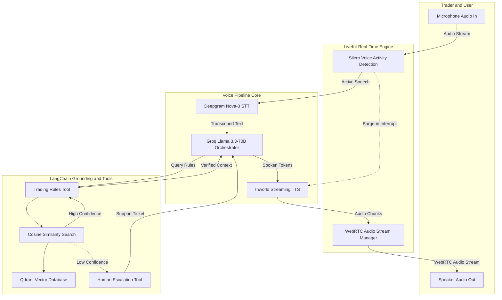

# ⚡ Axiom Trading — Voice-Enabled Prop Trading Rules AI Assistant

An ultra-low latency (<500ms), conversational AI voice agent built to answer high-stakes prop trading rules, drawdown limits, profit targets, and account policies with **zero hallucination**, natural real-time interruption (barge-in), and autonomous human escalation.

Built with **LiveKit WebRTC**, **Groq (Llama 3.3 70B)**, **Docling Hierarchical RAG**, and **Qdrant Vector Database**.

---

## 🏗️ System Architecture



---

## 🌟 Key Technical Features

### 1. Sub-500ms Conversational Latency
* **Deepgram Nova-3**: Sub-250ms real-time audio transcription.
* **Groq Llama 3.3-70B**: Time-to-First-Token $< 150\text{ ms}$ at 500+ tokens/second.
* **Inworld Streaming TTS**: Synthesizes and plays audio as soon as the first 3 tokens are generated.
* **Real-Time Barge-In (Interruption)**: Silero VAD detects user speech instantly, cutting off the agent mid-sentence without audio lag.

### 2. High-Precision Prop Trading RAG (Docling + Qdrant)
* **Docling Hierarchical Chunking**: Unlike naive character splitting that destroys financial tables, Docling extracts document headers into breadcrumbs (`Evaluation Rules > Phase 1 > Drawdown Limit`), providing exact contextual boundaries for mathematical figures.
* **Sentence-Transformers (`all-MiniLM-L6-v2`)**: Generates 384-dimensional dense embeddings stored locally in Qdrant with cosine distance indexing.

### 3. Financial Zero-Hallucination & Autonomous Escalation
* **Strict Tool Grounding**: The LLM is constrained from inventing financial parameters.
* **Autonomous Escalation**: If a trading rule is ambiguous or absent from the knowledge base, the agent autonomously executes `escalate_to_human`, assigns a priority ticket (`AXIOM-XXXXX`), and delivers a professional voice handoff.
* **Off-Topic Deflection**: Sports, weather, and general trivia queries are gracefully declined without invoking database searches or filing false support tickets.

### 4. `SpeechOnlyGraph` Token Stream Filter
* Intercepts LangChain's `astream()` events to strip out intermediate `ToolMessage` payloads and JSON structures before reaching TTS, ensuring traders hear only natural spoken answers.

---

## 📁 Project Structure

```text
axiom-trading-voice-agent/
├── docs/
│   └── Axiom_Trading_Knowledge_Base.pdf   # Source trading rule documentation
├── src/
│   └── prop_trading_rules_voice_agent/
│       ├── __init__.py                     # Package export
│       ├── __main__.py                     # Lightweight text CLI tester
│       ├── config.py                       # Central Pydantic single source of truth
│       ├── ingest.py                       # Docling parsing & Qdrant indexing pipeline
│       ├── retriever.py                    # Semantic search & cosine similarity filtering
│       ├── tools.py                        # LangChain tools (@tool) & agent graph compilation
│       └── agent.py                        # LiveKit WebRTC VoicePipelineAgent worker
├── .env.example                            # Example configuration keys
├── .gitignore                              # Protects secrets, data, and cache
└── pyproject.toml                          # Hatchling build specification & dependencies
```

---

## 🚀 Quickstart & Setup

### 1. Prerequisites
* Python $\ge$ 3.12
* [uv](https://docs.astral.sh/uv/) (recommended) or standard virtualenv

### 2. Clone & Install Dependencies
```powershell
git clone https://github.com/farazahmad-ai/axiom-trading-voice-agent.git
cd axiom-trading-voice-agent

# Install dependencies using uv
uv sync
```

### 3. Configure Environment Variables
Copy `.env.example` to `.env` and fill in your keys:
```powershell
cp .env.example .env
```
Ensure your `.env` contains:
```ini
LIVEKIT_URL=wss://your-project.livekit.cloud
LIVEKIT_API_KEY=your_livekit_api_key
LIVEKIT_API_SECRET=your_livekit_api_secret
GROQ_API_KEY=gsk_your_groq_api_key
```

### 4. Ingest the Knowledge Base
Parse `Axiom_Trading_Knowledge_Base.pdf` and build the local Qdrant vector index:
```powershell
uv run python -m prop_trading_rules_voice_agent.ingest
```

---

## 🧪 Testing the Voice Agent (LiveKit Playground)

1. Start the Voice Agent Worker in development mode:
   ```powershell
   uv run python -m prop_trading_rules_voice_agent.agent dev
   ```
   *(You will see the agent connect to your LiveKit Cloud room and stand by for calls).*

2. Open the official **LiveKit Agents Playground** in your browser:  
   👉 **[https://agents-playground.livekit.io/](https://agents-playground.livekit.io/)**

3. Fill in your credentials:
   * **LiveKit URL**: `wss://your-project.livekit.cloud`
   * **API Key**: `your_livekit_api_key`
   * **API Secret**: `your_livekit_api_secret`

4. Click **Connect**, unmute your microphone, and speak naturally to the agent!
   * *Try asking:* "What is the difference between static and trailing drawdown?"
   * *Try interrupting:* Speak mid-sentence to test real-time barge-in.

